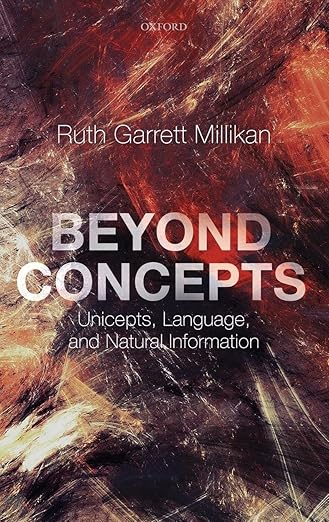
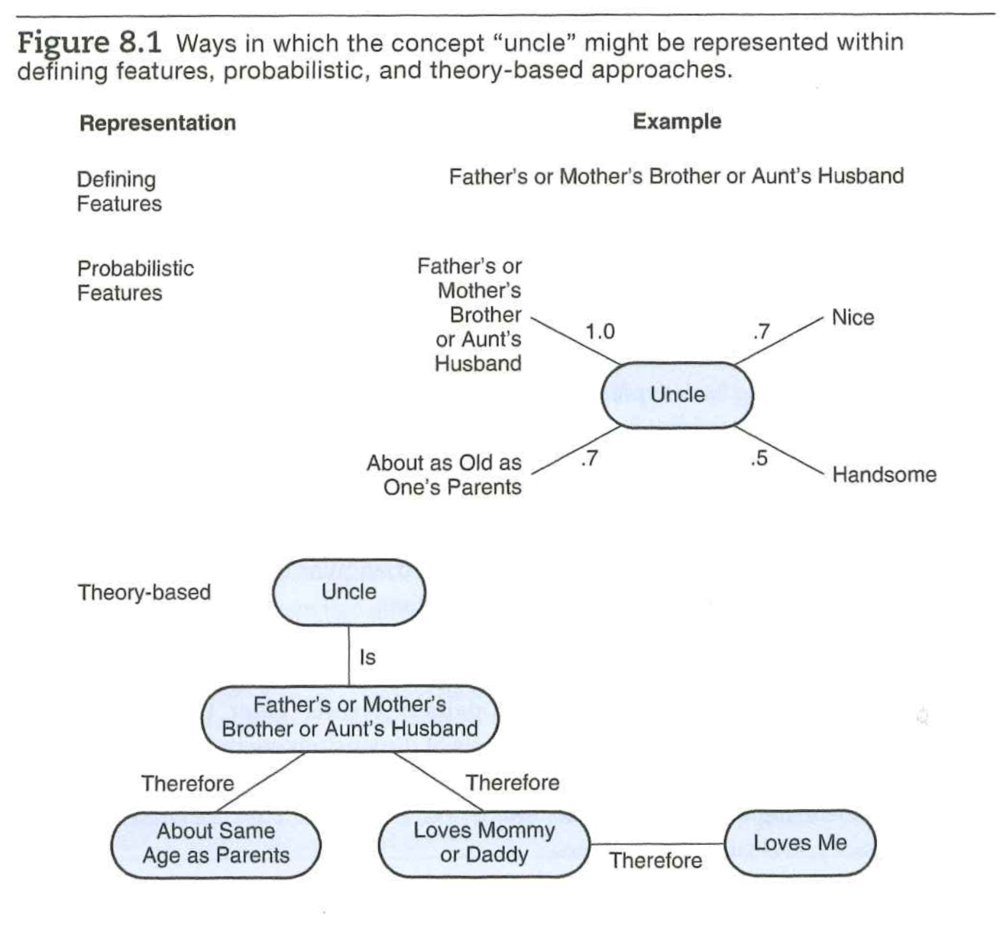
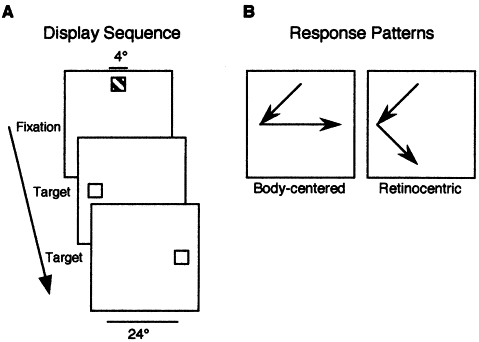
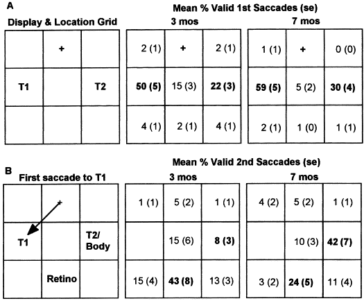
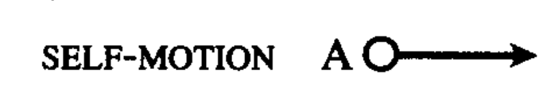
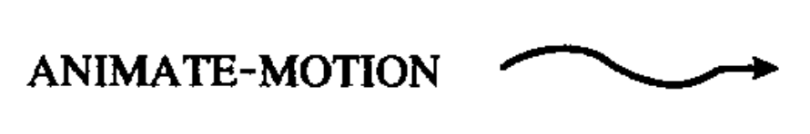
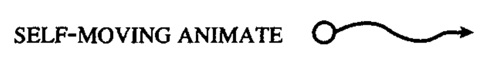
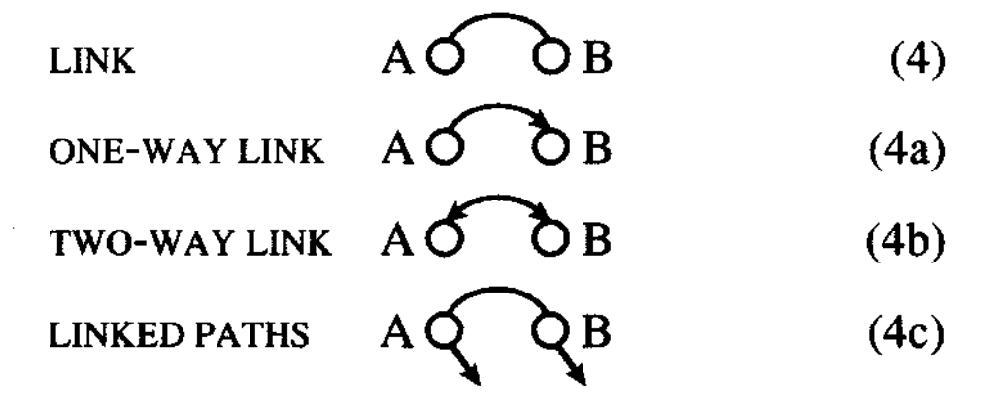
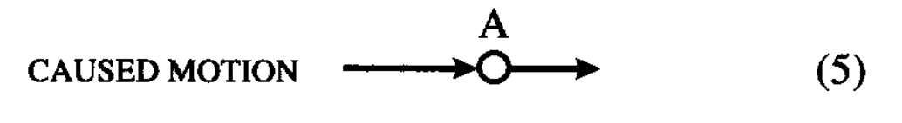
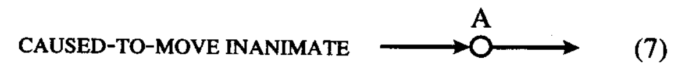

# Prelude

## Today's topics

- Conceptual development
  - *General Readings*: @Siegler2021-py Chapter 8; @Mandler1992-vb
  - *Student Presentation N*: Naive psychology (*Presenter*: Jiayi Fan : *Discussant*: Suzy Su)
    - *Read*: @Onishi2005-co; @Wellman2012-ny; @Ding2015-bp

# Conceptual development

## Before (beyond?) concepts

:::: {.columns}
::: {.column width=60%}
>To be able to recognize the same thing again as it evidences itself to one's senses in a multiplicity of ways, thus affording multiple opportunities to accumulate and apply information about it is...the most central challenge there is for cognition.

-- @Millikan2017-dn
:::
::: {.column width=40%}
{fig-align="right"}
:::
::::

## Conceptual representations

:::: {.columns}
::: {.column width=50%}
- Defining features
- Probabilistic
- Theory-based
:::
::: {.column width=50%}

:::
::::

## Younger $\neq$ older?

- Thematic vs. taxonomic grouping depends on task/context

::: {.fragment}
::: {.callout-note}
Differences in language comprehension complicate task development and interpretation.
:::
:::

## Sources of probabilistic representations

:::: {.columns}
::: {.column width=50%}
- Cue validities
  - e.g., P(birds fly) vs. P(non-birds fly)
- Category level
:::
::: {.column width=50%}


:::
::::

## Sources of probabilitic representations

- Correlations among features
- Prototypes

::: {.fragment}
- What are the statistics of children's experiences?
- What statistics do children capture from them?
:::

## Theory-based representations

- Concepts as partial theories
  - From what to *why*
- Causal relations
  - If $A\rightarrow B$, then $t_A < t_B$
- Hierarchical relationships

## Concepts about what: Core theories

- (naive) Physics
- People
  - (naive) Psychology
  - (naive) Sociology

## Concepts about what

- Space
  - From ego to allocentrism
- Time
  - Simultaneity, $t_1==t_2$, or more often $t_1=t_2\pm\delta, 0 < \delta < 1$
  - Sequential relations, $t_2 > t_1$
  - Durations
  
---


---


## Eye to body-centered saccades

:::: {.columns}
::: {.column width=50%}

:::
::: {.column width=50%}
::: {.fragment}

:::
:::
::::

## Regarding simultaneity

- Stroboscopic effect: <https://www.youtube.com/shorts/UFvTrL2cGMo>
- Within sensory streams vs. between
  - 20 ms from event to auditory cortex 
  - vs. 100 ms to visual cortex

## Perceiving simultaneity develops

:::: {.columns}
::: {.column width=50%}
- Audio-visual simultaneity perception not adult-like before ~9y [@Chen2016-do]
:::
::: {.column width=50%}

:::
::::
  
## How to build a baby?

:::: {.columns}
::: {.column width=50%}
- Jean Mandler
- @Mandler1988-sp; @Mandler1992-vb; @Mandler2005-za
:::
::: {.column width=50%}
{fig-align="right"}
:::
::::

## How to build a baby

- Infants engage in perceptual and *conceptual* categorization
- *Perceptual analysis*
  - Recoding perceptual information into a non-perceptual form
- *Image schemas* as conceptual primitives
  - Possible grounding for symbolic representation
  
## Illustrations

:::: {.columns}
::: {.column width=50%}
- Animacy
  - self-instigated vs. caused
  - contingency of motion
:::
::: {.column width=50%}



:::
::::

## Contingency

:::: {.columns}
::: {.column width=50%}
- Between events/agents
:::
::: {.column width=50%}

:::
::::

## Caused motion






## Agency

:::: {.columns}
::: {.column width=50%}
>AGENCY is represented as an animate object, A, that moves itself and also causes another object, B, to move

-- @@Mandler1992-vb

:::
::: {.column width=50%}

:::
::::

---

```{mermaid}
%%| label: fig-inferring-animacy
%%| fig-cap: "From perceptual to conceptual representation. Perceptual properties are in the trapezoids; concepts are in the trapezoidal shapes."
flowchart TD
  A([Entity_A]) ---|is seen in| M[/motion/]
  M ---|looks like| S[/self-motion/]
  M ---|looks| U[/unpredictable/]
  B([Entity_B]) ---|is seen as| N[/not moving/]
  S & U -->|implies| C{{animacy}}
  C -->|is property of| A
```

---

```{mermaid}
%%| label: fig-inferring-inanimacy
%%| fig-cap: "How A moving B affects conceptual representations."
flowchart TD
  A([Entity_A]) ---|makes contact with| B([Entity_B])
  B ---|is seen in| N[/motion/]
  N ---|looks| T[/not to be self-moving/]
  N ---|looks| P[/predictable/]
  T & P -->|implies| D{{inanimacy}}
  D -->|is property of| B
```

---

```{mermaid}
%%| label: fig-animate-vs-inanimate
%%| fig-cap: "Illustrating relationships between related concepts."
flowchart TD
  A{{animacy}} ---|opposite of| I{{inanimacy}}
  A --- P[/unpredictable motion/]
  A --- Q[/self-motion/]
  I --- R[/predictable motion/]
  I --- S[/caused motion/]
```

---

```{mermaid}
%%| label: fig-conceptual-network
%%| fig-cap: "Toward a network of concepts"
flowchart TD
  A{{animacy}} ---|opposite of| I{{inanimacy}}
  A --- P[/unpredictable motion/]
  A --- Q[/self-motion/]
  A --- S[/symmetric shape/]
  A --- T[/makes noise/]
  A --- U{{is alive}}
  A ---|implies| V{{agency}}
```

# Naive psychology

## *Student Presentation N* 

- *Presenter*: Jiayi Fan; *Discussant*: Suzy Su
  - *Read*: @Onishi2005-co; @Wellman2012-ny; @Ding2015-bp

# Wrap-up

## Next time...

- Systems
  - *Read*: @Bronfenbrenner1977-cm, @Oyama2001-cf, @Hartley2022-dd
  
## Next time...

  - *Student Presentation O*: Poverty is bad for cognition. (*Presenter*: Yeonjin Kim; *Discussant*: TBD)
    - *Read*: @Taylor2020-dp; @Amso2020-jo
  - *Student Presentation P*: Poverty can be adaptive for cognition. (*Presenter*: Caesar Liu; *Discussant*: Natalie Byrd)
    - *Read*: @Frankenhuis2016-wl; @Frankenhuis2020-ld

# Resources

## About

This talk was produced using [Quarto](https://quarto.org), using the [RStudio](https://posit.co/products/open-source/rstudio/)
Integrated Development Environment (IDE), version `r Sys.getenv("RSTUDIO_VER")`.

The source files are in R and R Markdown, then rendered to HTML using the
[revealJS](https://revealjs.com) framework.
The HTML slides are hosted in a [GitHub repo](https://github.com/psu-psychology/psy-548-fall) and served by GitHub pages:
<https://psu-psychology.github.io/psy-548-fall/>

## References
