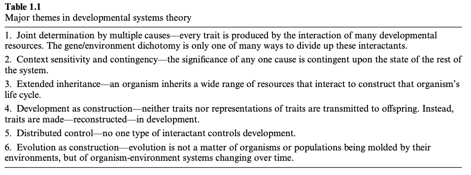
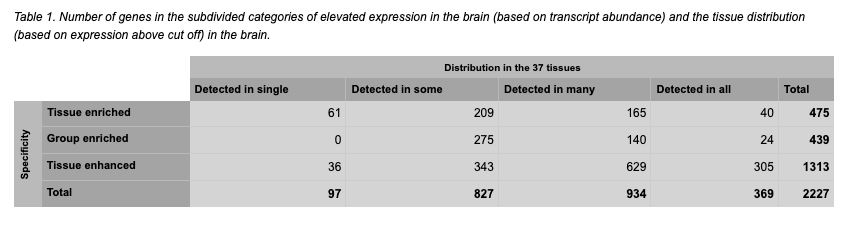
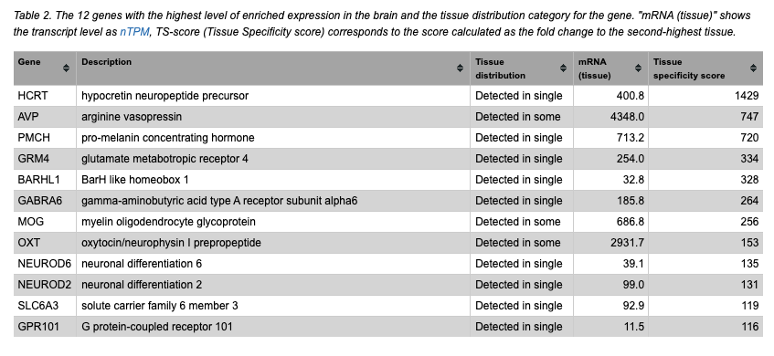
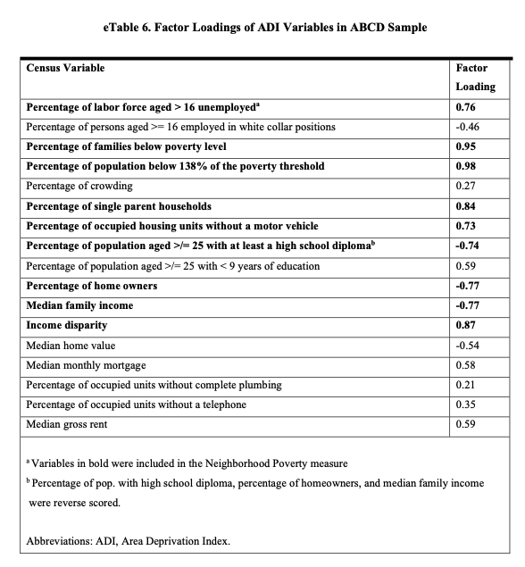

# Prelude

## Today's topics

- Systems
  - *Read*: @Bronfenbrenner1977-cm, @Oyama2001-cf pp. 1-6, @Hartley2022-dd

---

- *Student Presentation O*: Poverty is bad for cognition. (*Presenter*: Yeonjin Kim; *Discussant*: TBD)
    - *Read*: @Taylor2020-dp; @Amso2020-jo
- *Student Presentation P*: Poverty can be adaptive for cognition. (*Presenter*: Caesar Liu; *Discussant*: Natalie Byrd)
    - *Read*: @Frankenhuis2016-wl; @Frankenhuis2020-ld
  
# On systems

## Toward and experimental ecology of human development

>...rejects as spurious the argument that, because naturalistic observation preceded experimentation in both the physical and biological sciences, this progression is necessarily the strategy of choice in the study of human behavior and development. Such an interpretation mistakes a historical sequence for a causal one...

-- @Bronfenbrenner1977-cm

## Ecological environment

>DEFINITION 2. The ecological environment is conceived topologically as a nested arrangement of structures, each contained within the next.

## Nested structures

- Microsystem
  - Place, time, physical features, activity, participant(s), role(s)
- Mesosystem
  - System of microsystems
- Exosystem
- Macrosystem

---


## On ecological validity

>DEFINITION 3. Ecological validity refers to the extent to which the environment experienced by the subjects in a scientific investigation has the properties it is supposed or assumed to have by the investigator.

-- @Bronfenbrenner1977-cm p. 516

## On ecological experiments

>DEFINITION 4. An ecological experiment is an effort to investigate the progressive accommodation between the growing human organism and its environment through a systematic contrast between two or more environmental systems or their structural components, with a careful attempt to control other sources of influence either by random assignment (contrived experiment) or by matching (natural experiment).

---

>"Bronfenbrenner, if you want to understand something, try to change it."

::: {.fragment}
>In ecological research, the principal main effects are likely to be interactions...

:::

## Developmental Systems Theory



## On genetics

:::: {.columns}
::: {.column width=40%}
- Central dogma of molecular biology: Genetic information flows in one direction only (DNA -> RNA -> Protein)
:::
::: {.column width=60%}

:::
::::

## Genes and the brain

:::: {.columns}
::: {.column width=60%}
>At least a third of the approximately 20,000 different genes that make up the human genome are active (expressed) primarily in the brain. This is the highest proportion of genes expressed in any part of the body.

-- @UnknownUnknown-nt
:::
::: {.column width=40%}

:::
::::

## Genes and the brain



## Evolution in Four Dimensions

:::: {.columns}
::: {.column width=50%}
- @Jablonka2014-nv
- Genetic, epigenetic, behavioral, and symbolic inheritance systems
:::
::: {.column width=50%}
{fig-align="right"}
:::
::::


## Beyond the laboratory

>Laboratory tasks and stimuli lack the complexity of natural environments and may fail to capture the important statistical regularities that influence cognition – observations that have motivated calls for greater naturalism within cognitive science.

-- @Hartley2022-dd

---

>James Gibson famously argued for the importance of asking ‘not what’s
inside your head, but what your head’s inside of’.

-- @Hartley2022-dd

# Supplemental

---

```{mermaid}
flowchart LR
  P[poverty] ---> S(chronic stress)
  S ---> H(HPA axis)
  H ---> B(hippocampus)
```

::: {.fragment}
```{mermaid}
flowchart LR
  P[poverty] ---> S(chronic stress)
  S ---> H(HPA axis)
  H --->|cortisol| B(hippocampus)
  P ---> O[other factors]
  O ---> B
```
:::

::: {.fragment}
```{mermaid}
flowchart LR
  A[poverty] ---> B(PFC volume)
  A ---> C(PFC activity)
```

```{mermaid}
flowchart LR
  B(PFC volume) ---> C[cognitive function]
  D(PFC activity) ---> C
```
:::

---

```{mermaid}
flowchart LR
  A[Neighborhood poverty] ---> B(PFC volume)
  A ---> C(hippocampal volume)
  A ---> D[cognitive performance]
  E[SES] ---> B & C & D
```

```{mermaid}
flowchart LR
  A[Neighborhood poverty] ==> B(PFC volume)
  A ===> C(hippocampal volume)
  A ===> D[cognitive performance]
  E[SES] ---> B & C & D
```

---

```{mermaid}
flowchart LR
  A[Neighborhood poverty] --> B(PFC volume)
  A ---> C(hippocampal volume)
  A ---> D[cognitive performance]
  B -.-> D
  C -.-> D
```

---

```{mermaid}
flowchart TD
  A[household income] ---> B[SES]
  C[PRFQ] ---> B
```

---



---

```{mermaid}
flowchart TD
  1[unemployed] ---> B[Area Deprivation Index]
  2[families in poverty] ---> B
  3[pop < pov thresh] ---> B
  4[single parent] ---> B
  5[no car] ---> B
  6[HS ed] ---> B
  7[homeowner] ---> B
  8[med income] ---> B
  9[income disparity] ---> B
```

## Harshness vs. predictability

- How to simulate the history of harshness and predictability?

```{r}
#| label: fig-harshness-time-series
#| fig-cap: "Visualization of events that occur at different points in time with different magnitudes."
#| fig-align: center
#| 
t <- runif(10, min = 0, max = 25) |> 
  round(digits = 0) |>
  sort()
mag <- runif(length(t), min = 0, max = 2)

plot(t, mag)
```


# Resources

## About

This talk was produced using [Quarto](https://quarto.org), using the [RStudio](https://posit.co/products/open-source/rstudio/)
Integrated Development Environment (IDE), version `r Sys.getenv("RSTUDIO_VER")`.

The source files are in R and R Markdown, then rendered to HTML using the
[revealJS](https://revealjs.com) framework.
The HTML slides are hosted in a [GitHub repo](https://github.com/psu-psychology/psy-548-fall) and served by GitHub pages:
<https://psu-psychology.github.io/psy-548-fall/>

## References
